# UI-System v0 — Lofi-Konzept

Stand: 2026-10-23 · Status: Entwurf, Runde 1 · Fidelity: Lofi (Graustufen, keine Optik-Entscheidung)

> Review vom selben Tag ([Vision v1](../01-vision-v1.md), [ADR-004](../adr/004-client-ui-architecture.md)):
> Einstellungen werden das Modul „Ich“ statt eines Vollbild-Overlays, Soundboard- und
> App-Audio-Plätze bleiben ausgeblendet, bis die Engine sie kann, Beitreten per Einzelklick,
> Inspector standardmäßig zu. Der Rest gilt wie hier beschrieben.

Ziel dieser Runde: Struktur, Navigation und Usability der UI festlegen, bevor irgendetwas
gestaltet wird. Die App soll später deutlich mehr können als Voice (Hub, Chat, Minigames,
Tools). Deshalb muss das System mit neuen Features wachsen, ohne dass die Grundstruktur
umgebaut werden muss.

- Design-Canvas (privat): https://claude.ai/code/artifact/eb2a5d58-89d0-4726-9b0c-820a0c9224ff
- Screens als PNG: [`img/`](img/)
- Quellen der Artboards (`.dc.html`, Design-Canvas-Format): [`lofi-v0-src/`](lofi-v0-src/)

## Entscheidungen dieser Runde

| Thema | Entscheidung |
|---|---|
| Navigationsmodell | Ein Space („Die Gang“), Channel-Baum links. Space-Umschalter ist reserviert, wird erst aktiv bei mehr als einem Server. |
| Erweiterbarkeit | Neue Features = neue **Module** in einer festen **Shell**. Die Shell ändert sich nicht. |
| Feste Plätze schon jetzt | Soundboard und App-Audio/Radio (im Call). Hub, Games, Tools als reservierte Modul-Slots. |
| Mobile | **Später** (nach v1, nicht Teil des aktuellen Plans). Das Konzept unten ist geparkt, damit die Shell schon jetzt mobil-tauglich gedacht ist. |
| UI-Libraries | Für das Konzept nichts eingebunden; nur als Best-Practice-Referenz (siehe unten). |

## 1 · Das Shell-System (Desktop)

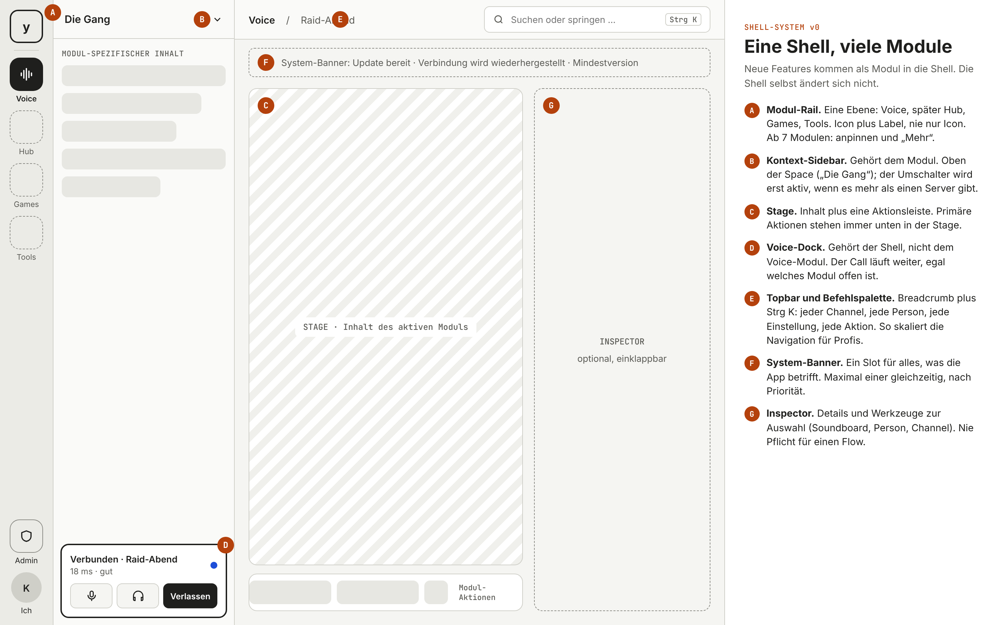

| Zone | Name | Regel |
|---|---|---|
| A | Modul-Rail | Eine Ebene: Voice, später Hub, Games, Tools. Icon **plus Label**, nie nur Icon. Unten: Admin (nur mit Rolle) und „Ich“ (Profil, Einstellungen). Ab 7 Modulen: anpinnen und „Mehr“. |
| B | Kontext-Sidebar | Gehört dem aktiven Modul (bei Voice: Channel-Baum mit Personen darin). Oben der Space-Name. |
| C | Stage | Inhalt des Moduls plus genau eine Aktionsleiste. Primäre Aktionen stehen immer unten in der Stage. |
| D | Voice-Dock | Gehört der **Shell**, nicht dem Voice-Modul. Status, Ping, eigener Pegel, Mute, Taub, Verlassen. Der Call läuft weiter, egal welches Modul offen ist. |
| E | Topbar + Befehlspalette | Breadcrumb plus `Strg K`: jeder Channel, jede Person, jede Einstellung, jede Aktion. So skaliert die Navigation für Profis, ohne dass die UI voller wird. |
| F | System-Banner | Ein Slot für alles, was die App betrifft (Update bereit, Reconnect, Mindestversion, Kill-Switch). Maximal eins gleichzeitig, nach Priorität. |
| G | Inspector | Optional, einklappbar. Details und Werkzeuge zur Auswahl (Soundboard, Person, Channel). Nie Pflicht für einen Flow. |

**Skalierungsregeln**

- Ein neues Feature bekommt einen Rail-Slot, eine eigene Sidebar und eine eigene Stage. Es darf
  weder das Voice-Dock noch die Topbar oder den Banner-Slot umbauen.
- Jedes Modul registriert seine Ziele und Aktionen in der Befehlspalette.
- Einfach/Profi ist eine Eigenschaft der Settings, nicht der Module.
- Theme kommt ausschließlich aus `ui-tokens/`. Die Lofi-Farben hier sind Platzhalter.

## 2 · Desktop-Kernscreens

### Im Call

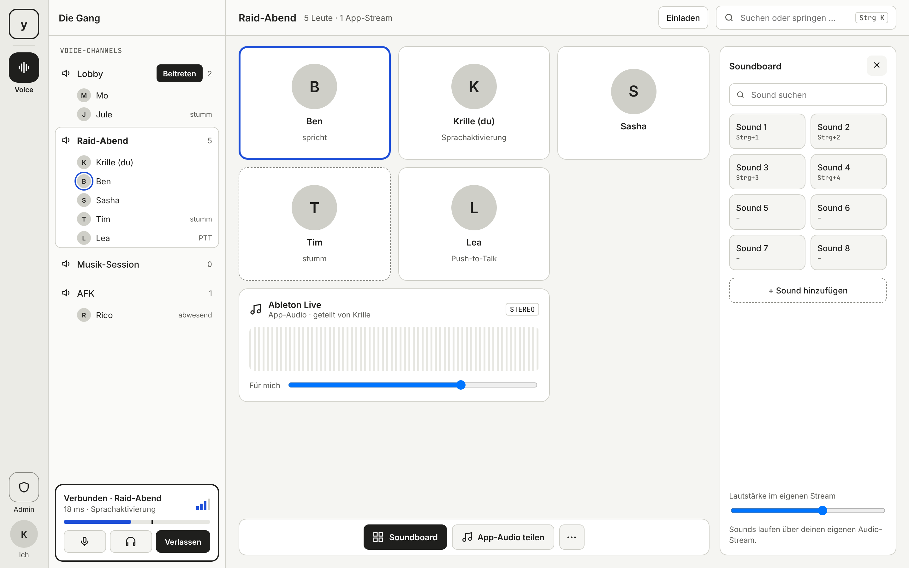

- Channel-Baum im TeamSpeak-Stil: Personen stehen direkt unter ihrem Channel, damit man sieht, wer wo ist, ohne irgendwo reinzugehen.
- Ein Klick auf einen Channel tritt bei, beim Hover erscheint „Beitreten“. Offen: Einzel- oder Doppelklick (siehe offene Fragen).
- Wer spricht, bekommt einen Ring bzw. Rahmen. Stumm ist gestrichelt dargestellt. Alle Zustände sind auch als Text da, nicht nur über die Farbe.
- **App-Audio** ist eine eigene, breite Kachel im Call (Quelle, wer teilt, Lautstärke nur für mich).
- **Soundboard** öffnet sich im Inspector: suchen, Grid, Hotkeys, „Sound hinzufügen“, Lautstärke im eigenen Stream. Sounds laufen über den eigenen Audio-Stream (siehe Grobstruktur).
- Lobby-Radio (später): eine leere Stage, wenn man allein ist, mit „Radio läuft (lokal)“. Noch nicht gezeichnet.

### Onboarding per Invite

| 1 · Name | 2 · Mikro | 3 · Reden |
|---|---|---|
| 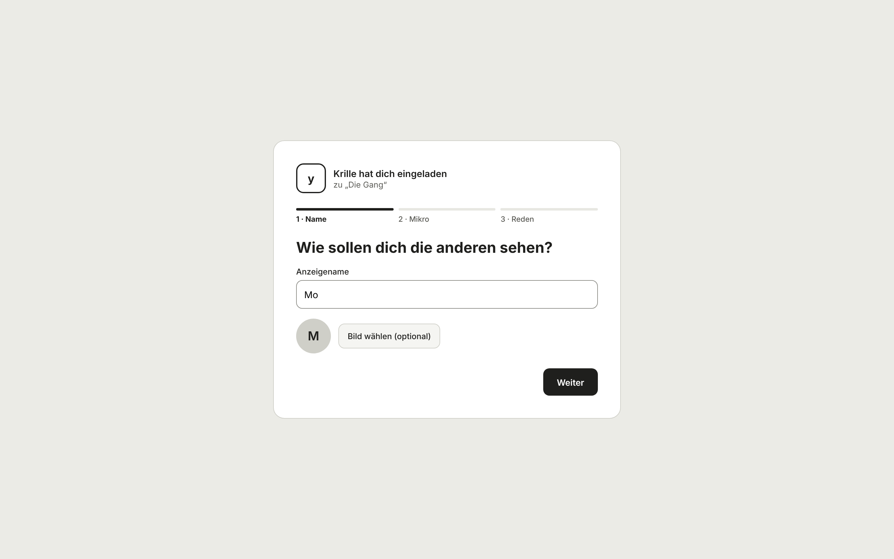 | 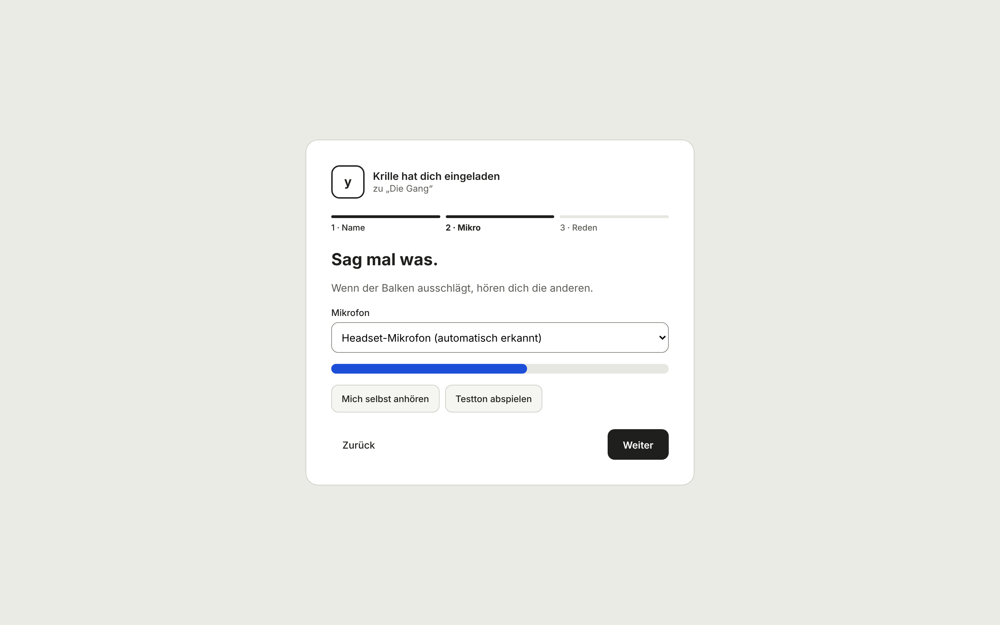 | 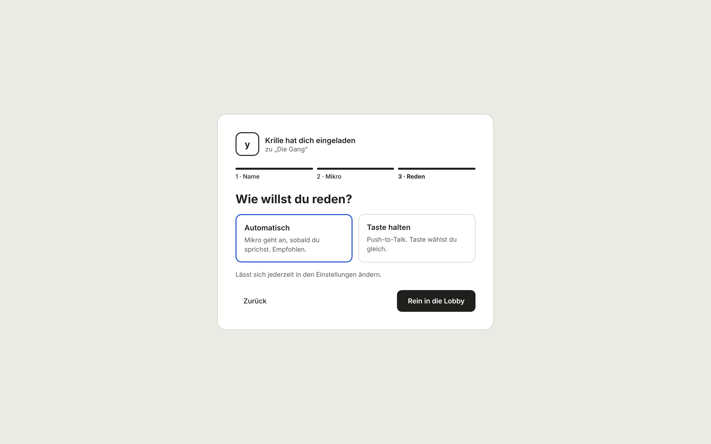 |

Drei Schritte, danach landet man direkt in der Lobby. Das Mikro wird automatisch erkannt und
sofort mit Live-Pegel getestet. Der Sprechmodus („Automatisch“ empfohlen, „Taste halten“ für
PTT) ist in Alltagssprache formuliert, die Fachbegriffe stehen nur im Profi-Bereich.

### Einstellungen: Einfach und Profi

| Einfach | Profi |
|---|---|
| 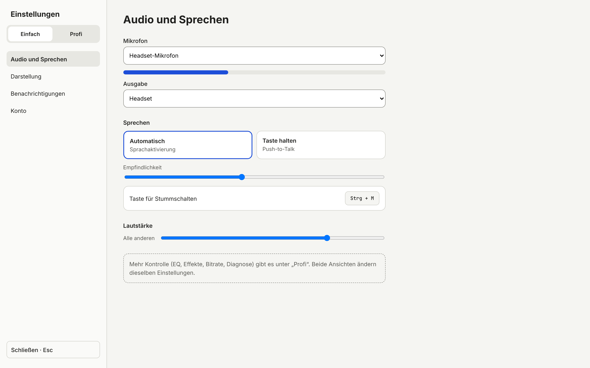 | 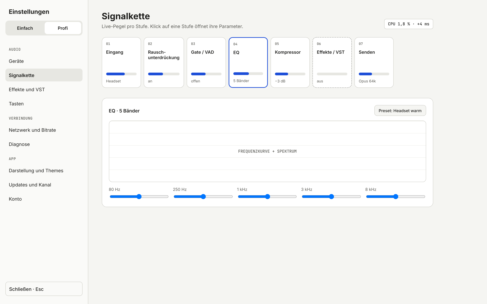 |

- Der Umschalter sitzt oben in der Settings-Navigation. Beide Ansichten schreiben dasselbe Settings-Schema aus `engine-protocol`.
- **Einfach** hat vier Bereiche: Audio und Sprechen, Darstellung, Benachrichtigungen, Konto.
- **Profi** ergänzt Geräte, Signalkette, Effekte/VST, Tasten, Netzwerk/Bitrate, Diagnose sowie Updates und Update-Kanal.
- Die Signalkette ist als Reihe von Stufen dargestellt, jede mit Live-Pegel. Ein Klick öffnet die Parameter. CPU und Zusatzlatenz der Kette sind immer sichtbar (vgl. Latenzbudget).
- Settings sind ein Vollbild-Overlay, mit `Esc` geht es zurück. Der Call läuft weiter.

### Admin

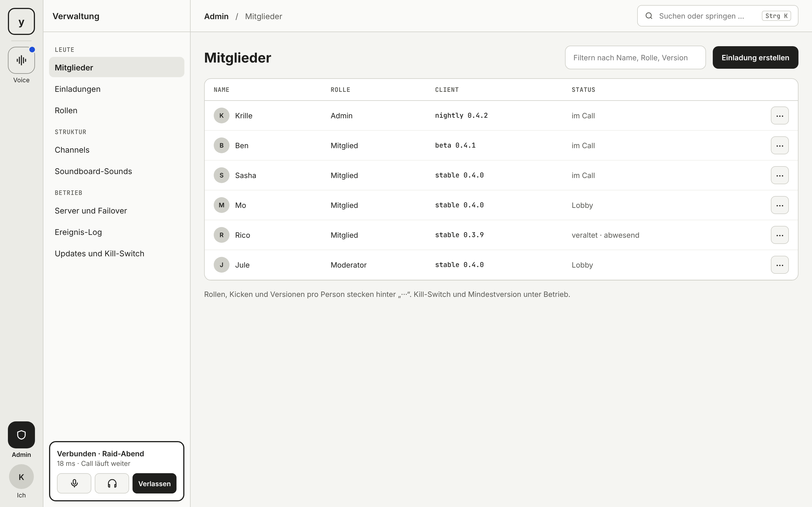

- Admin ist ein Modul in der Rail und nur mit Admin-Rolle sichtbar. Das Voice-Dock bleibt da, der Call läuft weiter.
- Navigation: Leute (Mitglieder, Einladungen, Rollen) · Struktur (Channels, Soundboard-Sounds) · Betrieb (Server und Failover, Ereignis-Log, Updates und Kill-Switch).
- Die Client-Version pro Person ist sichtbar, damit man veraltete Clients sofort erkennt.

## 3 · Mobile (später, geparkt)

> Mobile kommt **nach v1**. In der Grobstruktur ist das von „Nicht-Ziel“ auf „Später“ gesetzt.
> Ein voller Voice-Client auf Mobile heißt: Die Rust-Engine braucht `AudioDevice`- und
> Realtime-Implementierungen für iOS und Android. Bevor das in `TASKS.md` landet, braucht es
> eine ADR.

Damit die Shell schon jetzt mobil-tauglich gedacht ist, hier die Abbildung der Zonen:

| Shell | Channels | Im Call | Ich |
|---|---|---|---|
| 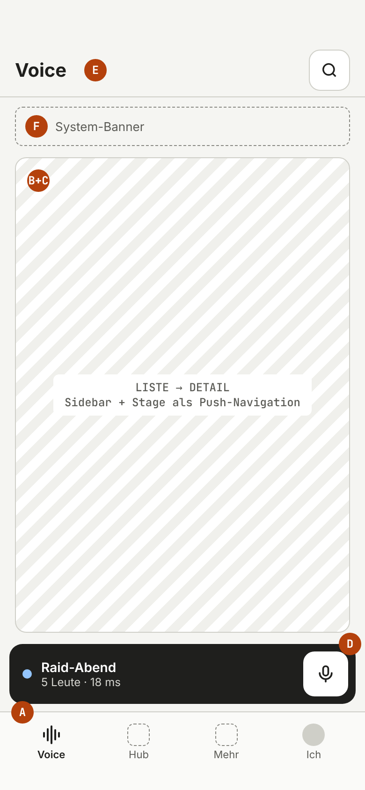 | 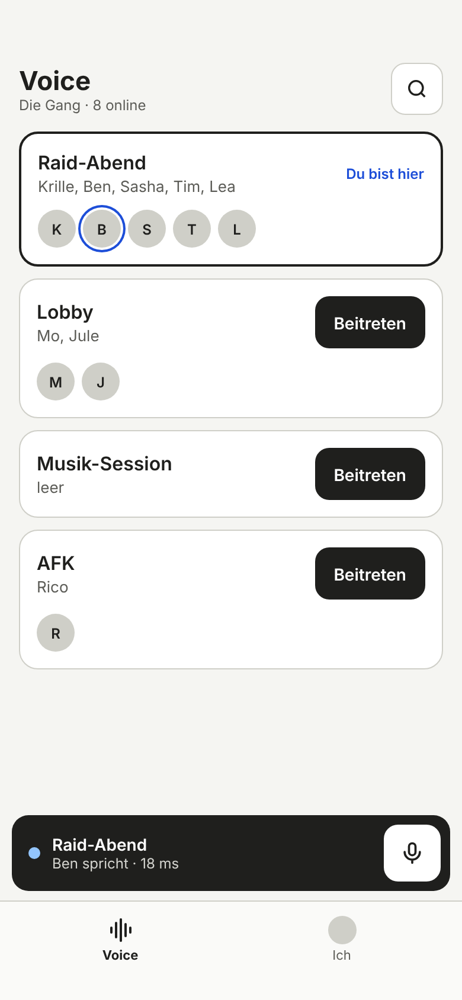 | 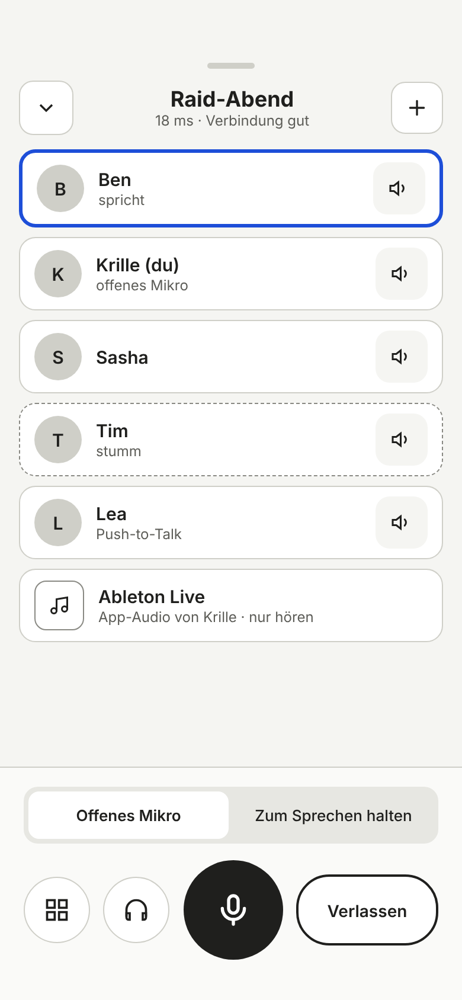 | 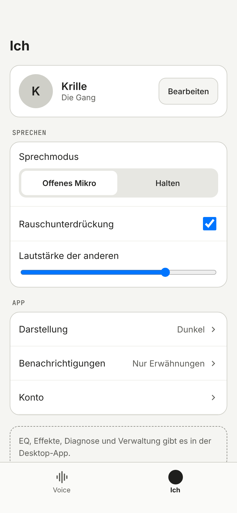 |

- **A → Tab-Bar:** maximal 4 Tabs plus „Mehr“.
- **D → Mini-Call-Leiste** über der Tab-Bar (Muster: Mini-Player). Mute ist immer unter dem Daumen. Antippen öffnet den Call als Vollbild-Sheet.
- **B + C →** Liste und Detail per Push-Navigation mit Zurück-Geste.
- Im Call sitzt alles Wichtige im unteren Drittel. Der Mute-Button ist 84 px groß, alle Touch-Ziele sind mindestens 44 px.
- Kein Admin, keine Profi-Settings, keine Hover-Zustände. Unter „Ich“ steht der Hinweis, dass es EQ, Diagnose und Verwaltung in der Desktop-App gibt.

## Best Practices und Library-Kandidaten (noch nicht eingebunden)

| Bedarf | Kandidat | Warum |
|---|---|---|
| Headless-Komponenten (Svelte 5) | Bits UI / shadcn-svelte | Accessibility und Tastaturbedienung sind gelöst, das Styling kommt komplett aus unseren Tokens |
| Befehlspalette | Command-Komponente aus Bits UI | Fertiges Muster für `Strg K` |
| Icons | Lucide | Outline-Set, MIT-Lizenz, Svelte-Paket |
| Muster Rail + Kontext-Sidebar | VS Code, Slack, Teams | Bewährt für „viele Bereiche, eine Shell“ |
| Muster Mini-Call | Mini-Player aus Musik-Apps | Persistenter Status über dem Tab-Bar |

Die endgültige Wahl braucht eine ADR (Lizenz, Bundle-Größe, Tauri-Tauglichkeit).

## Accessibility-Leitplanken (gelten ab jetzt)

- Echte `<button>`, `<a>` und `<input>` mit Label. Icon-only-Buttons bekommen ein `aria-label`.
- Zustände (spricht, stumm, PTT) immer auch als Text, nie nur über Farbe.
- Kontrast mindestens 4,5:1. Touch-Ziele mindestens 44 px.
- Alles ist per Tastatur erreichbar, `Strg K` ist der schnellste Weg überallhin.

## Offene Fragen für Runde 2

1. Channels beitreten per Einzelklick (aktuell) oder per Doppelklick (TeamSpeak-Gewohnheit)?
2. Ist der Inspector im Call standardmäßig zu und öffnet sich nur für Soundboard oder Person?
3. Lobby-Radio-Zustand zeichnen, ebenso Reconnect und Offline sowie Update-Banner.
4. Danach: Richtung der Optik (2–3 Varianten auf Basis der Tokens).
